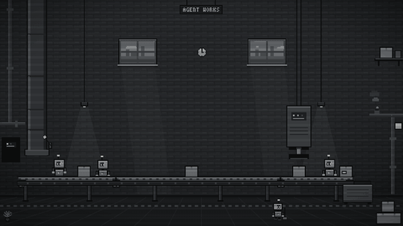

# Agent Works — a T3 Code theme

A calm, animated pixel-art factory for [T3 Code](https://github.com/pingdotgg/t3code). Little TV-headed agent robots run a box assembly line in the grays of a '90s black-and-white CRT.



## What's in the scene

- A box drops from the chute when the lever robot pulls it, then rides the belt and stops at each station on a 4-second loop.
- The inspector robot gives it a ✓, the press stamps a label, the tape robot seals it, and the box tips into the bin.
- On the factory floor, one robot carries a box and another sweeps.
- Clouds and chimney smoke drift past the windows, a steam pipe puffs, the clock ticks, the lamps and the sign flicker.
- Scanlines, a vignette and a slow rolling band give it the old-CRT look.
- A small robot perches on the composer's top edge, follows the end of your text and types faster while you're typing.
- The animation pauses when the system's "reduce motion" setting is on.

## Install

1. Download [`agent-works.json`](agent-works.json).
2. In T3 Code, open **Settings → Appearance** and click **Add theme**.
3. Choose the file, then select **Agent Works**.

It installs as a custom theme, so you can export or remove it from the same screen. The built-in theme editor may not keep the theme's custom CSS, which holds the whole scene, so make changes in `gen.py` instead.

## How it works

The scene is a 480×320 pixel-art SVG with its CSS keyframe animations inside it. It's embedded as a `data:` URI in the theme's `css` field, so the theme is one self-contained JSON file (~44K of the 50K character limit). The stations sit to the sides so the chat column covers only the quiet middle of the wall.

`gen.py` builds everything: sprites, scene layout, animation timing, the composer mascot, the rest of the UI styling and the color roles.

```sh
python3 gen.py out   # writes out/agent-works.json and out/factory.svg
```

To use a rebuilt version, import `out/agent-works.json` with **Add theme**. It has the same `agent-works` id, so T3 Code offers to update the installed theme.
