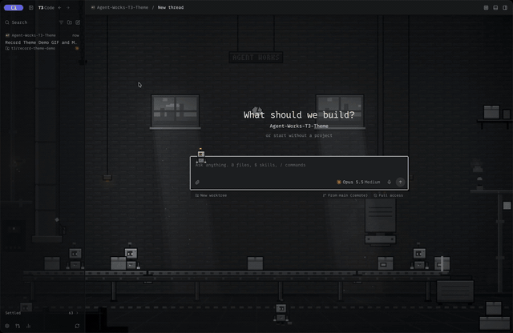

# Agent Works

An animated pixel-art factory theme for [T3 Code](https://github.com/pingdotgg/t3code). Little TV-headed robots run a box assembly line in the grays of an old black-and-white CRT, and when your agent starts working, the factory lights come on.



## Features

- **A living background.** A 20-second looping assembly line: a chute, an inspector, a press with sparks, a tape robot, a welder, steam, light shafts and drifting dust.
- **Lights on while the agent works.** The lamps, the **AGENT WORKS** sign and the belt chase lights switch on during a turn and go dark when it ends.
- **A sidebar that reacts too.** The factory continues behind the thread list, and an amber rail runs down its edge while any agent is working.
- **Hold state.** When an agent waits for your approval or an answer, the lamps blink slowly and hazard tape wraps the request.
- **A composer mascot.** A small robot sits on the composer and starts typing when you do.
- **Matching UI.** Menus, the command palette, toasts and settings all get the same steel-and-amber look.
- **Reduced motion.** All animation stops when your system's "reduce motion" setting is on.

## Install

```sh
git clone https://github.com/JamalLyons/Agent-Works-T3-Theme.git
cd Agent-Works-T3-Theme
./install.sh
```

Then in T3 Code, open **Settings → Appearance** and select **Agent Works**.

> [!IMPORTANT]
> Use `./install.sh`, not **Add theme** in T3 Code's settings. T3 Code only loads the animated background for themes in its themes folder (`~/.t3/userdata/themes`). If you already added Agent Works with **Add theme**, remove that copy in **Settings → Appearance** first.

- **Update:** pull the latest changes and run `./install.sh` again.
- **Uninstall:** run `./uninstall.sh`, then pick another theme.

The install needs Python 3. Tested on T3 Code (Beta) 0.1.10 on macOS. The theme hooks into T3 Code's markup, so a future app update can break parts of it; please open an issue if something looks off.

## Development

The theme is generated by `gen.py` and `fx.py`, and the background is rendered in a headless browser by `render/render.sh`. Run the checks with:

```sh
python3 -m unittest discover -s tests
```

See [AGENTS.md](AGENTS.md) for how the build works and the T3 Code details it depends on.

## License

[MIT](LICENSE)
